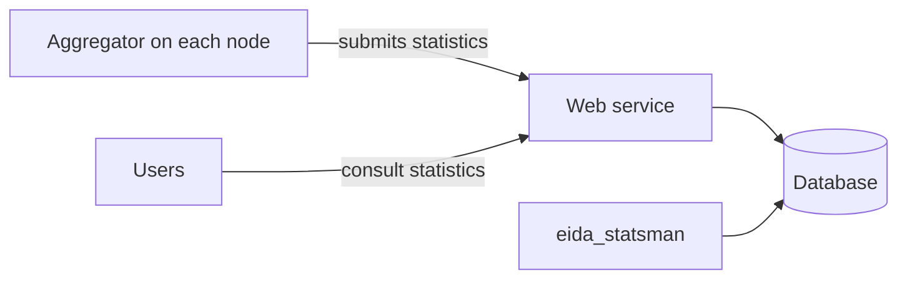

# Example: eida-statistics

[eida-statistics](https://github.com/EIDA/eida-statistics) is made of several
parts, so each part gets its own copy of the template. Descriptions are quoted
from its [README](https://github.com/EIDA/eida-statistics/blob/main/README.md).

## In the repository

```
eida-statistics/
  backend_database/       code, unchanged
  eida_statsman/          code, unchanged
  webservice/             code, unchanged
  docs/
    index.md              overview + Components
    webservice/           text from webservice/README.md
      index.md
      user/usage.md
      operator/install.md
      developer/development.md
    eida_statsman/        text from eida_statsman/README.md
      index.md
      operator/install.md
      operator/usage.md
    database/             text from backend_database/README.md
      index.md
      operator/install.md
      developer/development.md
```

## On the site

Each tab lists the parts that have pages for its role:

```
Node operators
  eida-statistics
    Overview
    webservice
      Install
    eida_statsman
      Install
      Usage
    database
      Install
```

## Components section of `docs/index.md`

| Component | Docs | What it does | For |
|---|---|---|---|
| Aggregator | separate repository: [eida-statistics-aggregator](https://github.com/EIDA/eida-statistics-aggregator) | "meant to be deployed on each EIDA node" | operator |
| Centralized statistics web service | `webservice/` | "able to receive logging statistics as provided by the aggregator. It stores the logging statistics in a database." | user, developer |
| Centralized service management service | `eida_statsman/` | "A command line interface to manage the central database system" | operator |
| Database | `database/` | Containerized PostgreSQL | operator |

In the real `docs/index.md`, each folder is a link to that part, for example
`[Web service](webservice/index.md)`.


