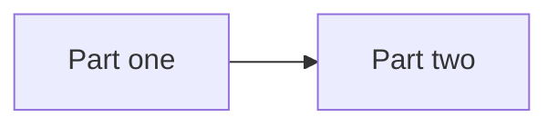

# Service docs template

Copy [`doc_template`](https://github.com/EIDA/doc/tree/main/doc_template) into
your repository as `docs/`:

```bash
cp -r doc_template my-repo/docs
```

1. Replace `{{ service }}`, `{{ author }}` and `{{ created_at }}` on every page.
2. Move your existing text into the pages, replacing the `<!-- ... -->` comments.
3. Delete the pages you have no content for.
4. On each page, keep only the tags that apply.

```
docs/
  index.md          Overview, shown in each tab the service appears in
  user/             pages for end users: usage, troubleshooting
  operator/         pages for node operators: install, configuration, troubleshooting
  developer/        pages for developers: development
```

## Rules

- Move existing text into the pages. Do not rewrite it.
- The folder decides where a page appears: `user/` under End users,
  `operator/` under Node operators, `developer/` under Developers.
- Tags (`user`, `operator`, `developer`) are labels on the page only.
- Links between pages are relative, also across folders, for example
  `../operator/install.md`; links to anything else use a full URL.

## Services with several parts

Give each part its own copy of the template, as a folder inside `docs/`:

```bash
cp -r doc_template my-repo/docs              # overview: keep index.md only
cp -r doc_template my-repo/docs/part-one
cp -r doc_template my-repo/docs/part-two
```

```
docs/
  index.md          overview with the Components table
  part-one/         same layout as any service: index.md, user/, operator/, ...
  part-two/
```

- In the top `index.md`, add a Components section after the introduction
  (see below).
- Each part's text comes from that part's own README.

Components section for the top `index.md`:

````markdown
## Components

| Component | Docs | What it does | For |
|---|---|---|---|
| Part one | [Part one](part-one/index.md) | Description from its README | operator |
| Part two | [Part two](part-two/index.md) | Description from its README | developer |


````

## Examples

- [eida-statistics](examples/eida-statistics.md): a service made of several parts
- [ws-availability](examples/ws-availability.md): a README split into pages
